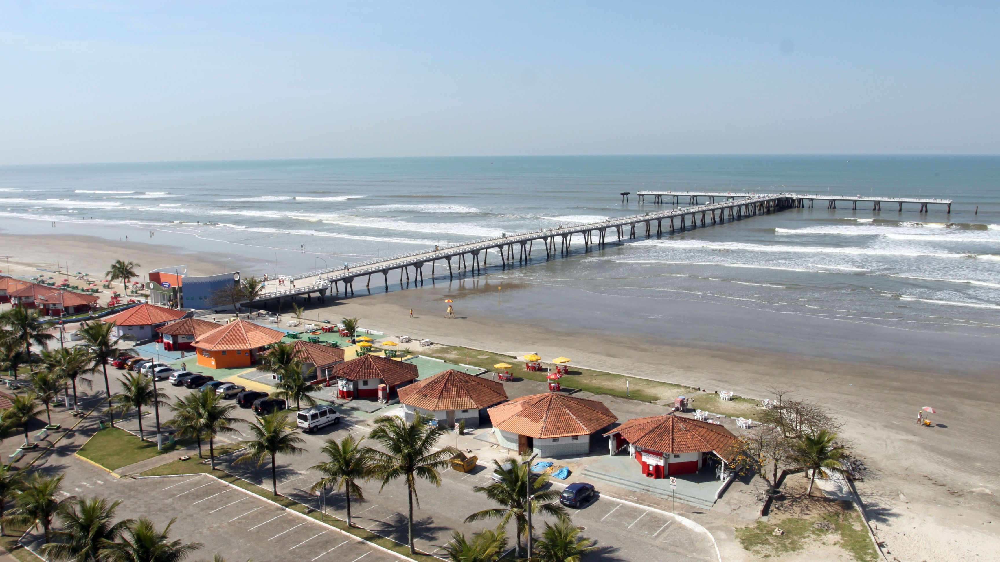
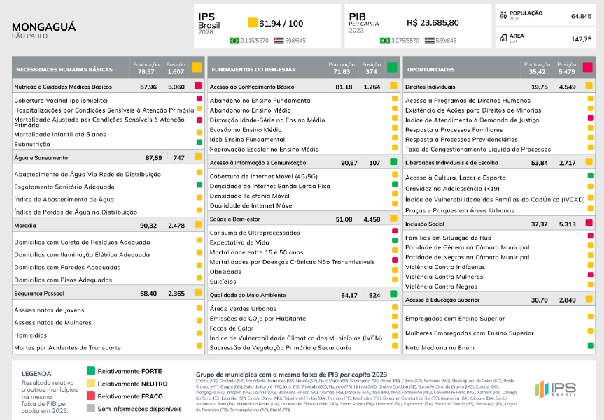
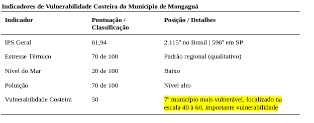

# Mongaguá

### Vulnerabilidade Costeira 50 - importante vulnerabilidade

[Mongaguá](https://cidades.ibge.gov.br/brasil/sp/mongagua/panorama)  (24°05′15″S, 46°37′44″W), possui área de 142,75 km² e população estimada de 64.845 habitantes*. Foi emancipada em 1959, mas teve um importante crescimento populacional (33,82%) entre 2010 e 2022. 

Fonte: Costa Norte.

Apresenta IPS de 61,94 (2.115ª colocação nacional e 596ª no estado), e a dimensão Oportunidades, com nota de 35,42 (5.479ª posição), é a mais baixa da Baixada Santista.

Fonte: IPS Brasil, 2026.

Cerca de 80% do território ainda é florestado, junto a encostas íngremes, mas o crescimento urbano desordenado tem avançado sobre as áreas mais frágeis. 

Em janeiro de 2026, três eventos em sequência mostraram o efeito acumulado da falta de planejamento territorial adequado: 1) Um temporal em 4 de janeiro deixou cerca de 30 pessoas desabrigadas; 2) Entre 19 e 21 de janeiro, novas chuvas levaram a prefeitura a decretar situação de emergência e a pedir ajuda humanitária; 3) No final do mês, um ciclone extratropical com ventos de até 70 km/h chegou quando a cidade ainda se recuperava, com prejuízos superiores a R$ 2 milhões. 

O principal risco apontado foi a saturação do solo, que aumenta a chance de deslizamentos mesmo com chuvas menores. O município não consta do levantamento de sedimentos do projeto, o que indica ausência de dado, e não ausência de contaminação.

---------
*Estimativa relativa ao ano de 2025, do IPS Brasil 2026.