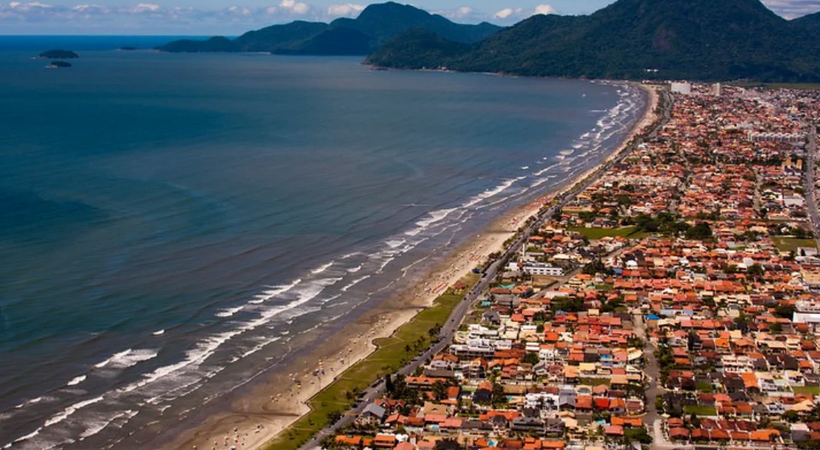
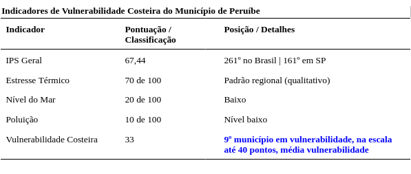
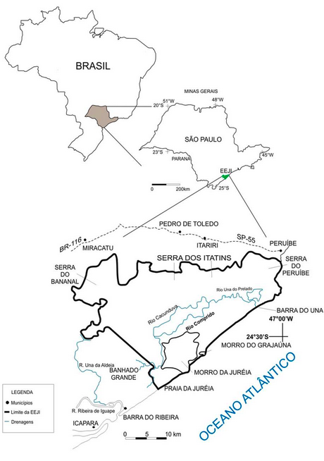

# Peruíbe

### Vulnerabilidade Costeira 33 - média vulnerabilidade

**Sirene de Iemanjá**, [ouça no Podomatic](https://www.podomatic.com/podcasts/lab-ecohumana-unisantapodcast/episodes/2026-11-12T10_50_32-08_00)

[Peruíbe](https://cidades.ibge.gov.br/brasil/sp/peruibe/panorama)  (24°19′12″S, 46°59′54″W), possui área de 326,22 km² e uma população estimada de 70.629 habitantes. Fundada em 18 de fevereiro de 1959, é a cidade menos vulnerável pelo cálculo de Siren.

Fonte: Top Destinos SP.

Apresenta IPS de 67,44 (261ª colocação nacional e 161ª no estado), o segundo melhor da região, com a dimensão Água e Saneamento em 89,76, relativamente forte. A exposição ao avanço do mar é a menor da região.

Fonte: IPS Brasil, 2026.

Mesmo assim, as chuvas atingiram o município em 2026 com intensidade. Em fevereiro, um temporal registrou 56 mm em um dia e mais de 280 mm em três dias, deixando mais de [300 pessoas desabrigadas](https://agenciabrasil.ebc.com.br/geral/noticia/2026-02/chuvas-desabrigam-mais-de-300-pessoas-em-peruibe) e cerca de 100 desalojadas, e a prefeitura decretou situação de emergência. O [governo estadual](https://www.agenciasp.sp.gov.br/governo-de-sp-reforca-atendimento-e-vistorias-em-areas-alagadas-em-peruibe/) montou três abrigos e acolheu 231 pessoas, e a enchente atingiu áreas próximas a rios, como o Jardim Caraguava. Em 12 de março de 2026, menos de um mês depois, um novo alagamento deixou [60 moradores desabrigados](https://spdiario.com.br/noticias/noticias-de-sp/chuvas-intensas-voltam-a-causar-alagamentos-em-peruibe-e-60-moradores-sao-levados-para-abrigo.html0). 

Peruíbe também possui uma grande área de Mata Atlântica perservada, [integrada à Estação Ecológica Juréia-Itatins](https://uc.socioambiental.org/arp/880), que abriga trilhas, cachoeiras, populações indígenas e caiçaras.

Fonte: [Willian Sallun Filho](https://www.researchgate.net/figure/Figura-1-Mapa-simplificado-da-Estacao-Ecologica-de-Jureia-Itatins-e-arredores_fig1_261287951).

O município não consta do levantamento de sedimentos do projeto, o que indica ausência de dado, mas não a de contaminantes.

